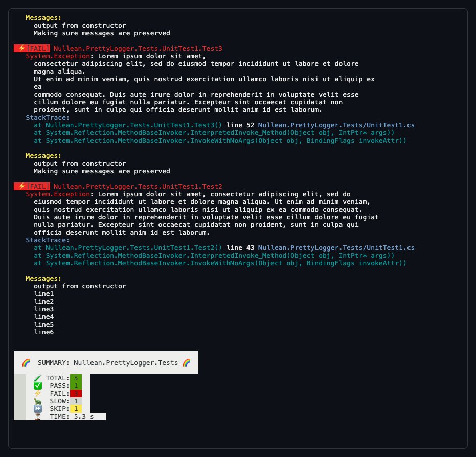

<p align="center">
  <a href="https://github.com/nullean">
    <picture>
      <source media="(prefers-color-scheme: light)" srcset="https://raw.githubusercontent.com/nullean/nullean.github.io/main/assets/nullean-lockup-light-544x192.png">
      
    </picture>
  </a>
</p>

<p align="center">A VSTest logger for <code>dotnet test</code> that replaces the default console output: a coloured line for every failed, skipped or slow test, readable stack traces, every failure repeated at the end, and a summary.</p>

<p align="center">
  <a href="https://www.nuget.org/packages/Nullean.VsTest.Pretty.TestLogger"></a>
  <a href="https://github.com/nullean/vstest-pretty-logger/actions/workflows/ci.yml"></a>
</p>



<sub>The end of a run of the repository's sample tests (`tests/Nullean.PrettyLogger.Tests`), captured in a pseudo-terminal and replayed in xterm.js.</sub>

## Install

```sh
dotnet add package Nullean.VsTest.Pretty.TestLogger
```

## Quick start

Reference it from the test project, as a build-time dependency only, and point the project at a `.runsettings`
file:

```xml
<ItemGroup>
  <PackageReference Include="Nullean.VsTest.Pretty.TestLogger" Version="*" PrivateAssets="All" />
</ItemGroup>
<PropertyGroup>
  <RunSettingsFilePath>$(MSBuildProjectDirectory)\.runsettings</RunSettingsFilePath>
</PropertyGroup>
```

In the `.runsettings` next to it, turn the console logger off and this one on:

```xml
<RunSettings>
  <LoggerRunSettings>
    <Loggers>
      <Logger friendlyName="Console" enabled="False" />
      <Logger friendlyName="pretty" enabled="True" />
    </Loggers>
  </LoggerRunSettings>
</RunSettings>
```

Or pick it for a single run: `dotnet test --logger pretty`. Works for F# test projects too.

- **Clear feedback during tests.** Fast passing tests print no line; failed, skipped and slow tests (over two
  seconds, a fixed threshold) do.
- **Readable stack traces**, not a sea of red, with each test's output under its failure.
- **Every failure repeated at the end**, marked `[FAIL]` so they are easy to grep, then a summary of passed, failed,
  slow and skipped tests.
- **VSTest only.** It works with `dotnet test` on VSTest (xUnit v2, NUnit, MSTest with `Microsoft.NET.Test.Sdk`), not
  on Microsoft.Testing.Platform, which has no VSTest loggers. Other loggers can run next to it, such as
  `--logger GitHubActions`.

To hide the skipped tests of some namespaces, list their prefixes in a run parameter; they still count in the
summary:

```xml
<TestRunParameters>
  <Parameter name="DisableFullSkipMessages" value="MyTests.Examples.;MyTests.Slow." />
</TestRunParameters>
```

## Learn more

- Recordings: [a run with this logger](https://asciinema.org/a/363126) and, for comparison,
  [`dotnet test` out of the box](https://asciinema.org/a/363123)
- [Releases](https://github.com/nullean/vstest-pretty-logger/releases)
- [Contributing](https://github.com/nullean/.github/blob/main/CONTRIBUTING.md)

MIT licensed. Copyright Nullean and contributors.
